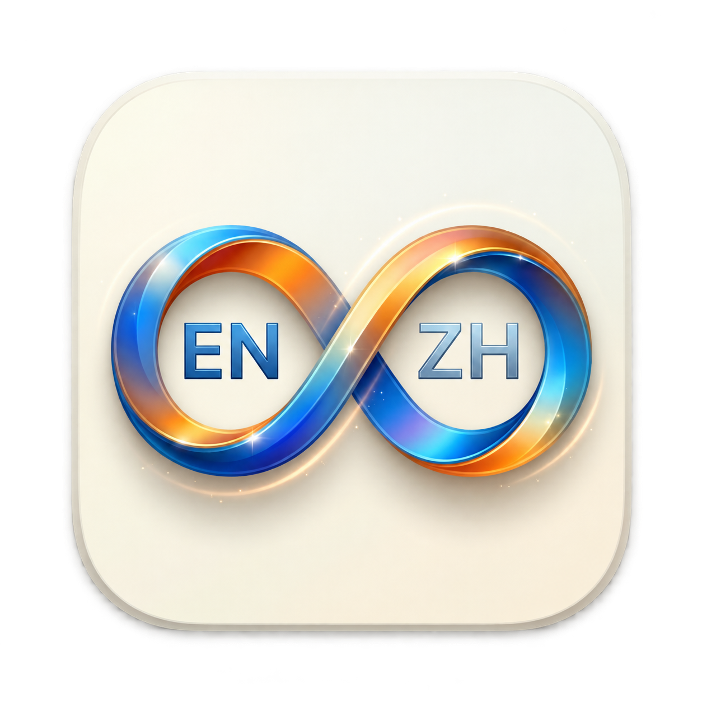
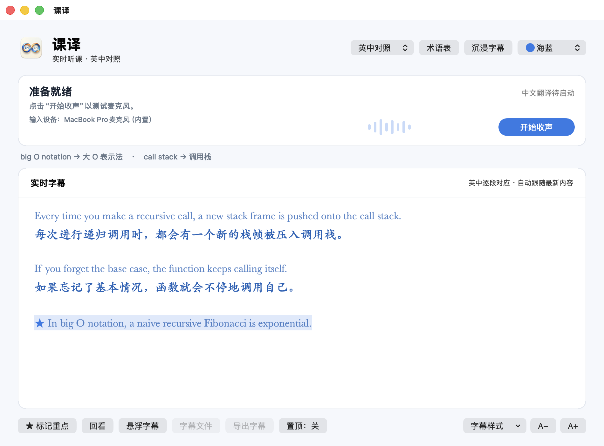

<p align="center"></p>

<h1 align="center">课译 · 实时英中课堂字幕</h1>

<p align="center">一款原生 macOS 应用：上英文课时，把老师说的话实时转成英文字幕并翻译成中文。<br>识别与翻译全部在本机完成，不联网、不需要账号、不保存录音。</p>

<p align="center"><i>Real-time English → Chinese lecture captions for macOS. Fully on-device.</i></p>



## 功能

- **实时英文字幕**：NVIDIA Nemotron 流式语音识别，约 1 秒出字，自动跟随最新内容。
- **逐句中文翻译**：使用 macOS 系统翻译（本机运行），英文一行、中文一行对照显示；送去翻译前自动去掉 um/uh 等口头禅和口吃重复。
- **专业词增强**：内置 300+ 条软件开发、数据库、网络等技术术语，可自己添加或导入 TSV；识别时优先听对这些词，并在下方提示中文释义。
- **标记重点（⌘B）**：老师强调的句子一键加星标和荧光底色，保存和导出时单独列出。
- **悬浮字幕与沉浸字幕**：小窗置顶看课件时同时看字幕，可选择最新字幕停在底部、中间或上方；术语栏固定在悬浮窗底部。
- **自动保存与导出**：上课时每秒自动保存英中字幕，意外退出也能找回；可导出 TXT、Markdown 学习笔记（重点、本节术语、总结、全文）或带时间轴的 SRT 字幕。
- **课后总结**：停止收声后，在末尾生成本节课的整体内容和重点。
- **个性化**：五种点缀色、浅色/深色外观、五种字幕字体（苹方、宋体、圆体、楷体、等宽）与多种字幕颜色，字幕平滑淡入。
- **完整快捷键**：⌘R 开始/停止、⌘B 标记重点、⌘L 回看、⌘F 查找、⌘= / ⌘- 调整字号、⇧⌘F 悬浮字幕。

## 系统要求

- macOS 26 或更新版本（当前构建目标为 Intel x86_64）
- Xcode Command Line Tools（用于从源码构建）
- 首次使用需允许麦克风权限，并在系统提示时下载英译中翻译语言包

## 从源码构建

模型权重较大（每个约 650MB），不放在仓库里，先运行下载脚本：

```sh
zsh Tools/fetch-models.sh          # 下载实时识别模型并校验 SHA-256
./build.sh                         # 生成 dist/课译.app
```

可选：`zsh Tools/fetch-models.sh --refine` 下载二次精确识别模型（Parakeet TDT 0.6B v2，实验功能），再用 `TINGYI_REFINE=1 ./build.sh` 打包。

课件词表 `Resources/coursepack.json` 属于个人学习资料，没有放进仓库；没有它时自动使用空的示例词表，内置技术术语仍然可用。

## 项目结构

| 路径 | 内容 |
|---|---|
| `Sources/Main.swift` | 主窗口、收声流程、菜单栏 |
| `Sources/RecognitionWorker.swift`、`StreamingDecoder.swift` | 实时语音识别 |
| `Sources/SentenceRefiner.swift`、`TwoPassTranscript.swift` | 二次精确识别（实验） |
| `Sources/ChineseTranslation.swift`、`TranslationText.swift` | 中文翻译与翻译前清理 |
| `Sources/CaptionTextView.swift`、`CaptionStyle.swift` | 字幕显示、动画、字体与颜色 |
| `Sources/Glossary*.swift` | 术语表 |
| `Sources/BilingualArchive.swift`、`LectureExport.swift` | 自动保存与导出 |
| `Tools/` | 自检程序、模型下载、准确率评测工具 |
| `docs/` | 功能路线图、各版本验收记录 |

## 分支

- `main`：生产分支，只放经过验证、可以安装使用的版本。
- `develop`：开发分支，日常开发在这里进行，验证后合并到 `main`。

## 致谢与许可

- 语音识别：[sherpa-onnx](https://github.com/k2-fsa/sherpa-onnx)（Apache-2.0）、NVIDIA Nemotron Speech Streaming 与 Parakeet TDT 模型、[Silero VAD](https://github.com/snakers4/silero-vad)
- 翻译：Apple Translation 框架
- 第三方许可证见 `Resources/Licenses/`，随应用一起打包。

自动识别与翻译可能有误，请以老师讲授和课件为准。
